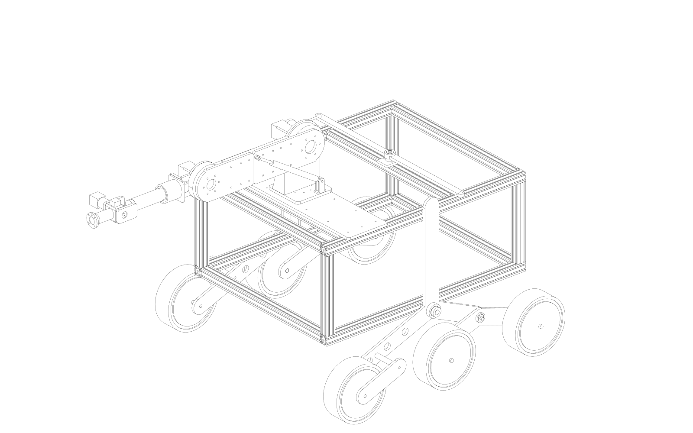
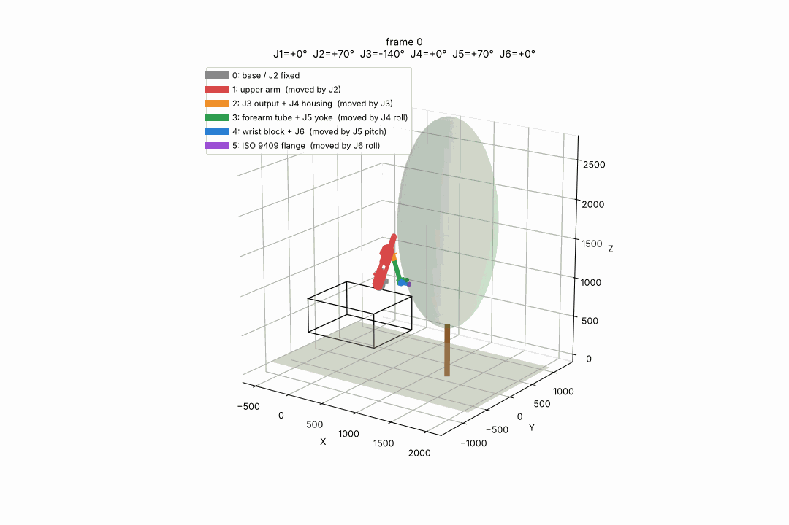

# orchard-rover

과수원 작업 로봇의 파라메트릭 기구 설계 — **6륜 Rocker-Bogie 구동체 + 6축 로봇팔 + 교환식 툴 인터페이스**.
모든 형상은 Python(CadQuery)으로 생성되며 STEP/STL/DXF를 내보냅니다. 치수·하중·기구학 계산은 pytest로 검증됩니다.



| 구동체 (Rocker-Bogie) | 6축 팔 | 작업 영역 |
|---|---|---|
| NASA MER/MSL 방식, 10" 휠, 전방 허브모터 2WD, 차동 바 | J1~J6, 리치 1,050 mm, 가반 3 kg, 사이클로이드 감속기 자체 설계 | 툴 팁 0~2.0 m, 전방 1.5 m |



## 구성

```
orchard_rover/
  rocker_bogie_params.py   서스펜션 치수·정역학·차동 기구학
  rocker_bogie_cad.py      서스펜션 CAD (STEP/STL/DXF/SVG)
  shoulder_joint.py        J2/J3 조인트: 사이클로이드 감속기(파라메트릭 프로파일) + 가스 스프링
  wrist_joint.py           J4 롤 / J5 피치 / J6 롤 + ISO 9409-1-50 플랜지
  arm_assembly.py          상완·전완·손목 조립
  base_joint.py            J1 베이스 요 + 구동체 결합 (전체 로봇 STEP)
  arm_check.py             관절 토크·스테퍼 속도-토크·처짐·전도·부품 강도 검증
  arm_workspace.py         순기구학·IK·작업 영역·궤적 애니메이션
  arm_pose_render.py       자세별 컬러 렌더 (matplotlib)
  cable_routing.py         케이블 번들 산정·관절별 여유 길이·드럼 경로
  transport_check.py       운반 자세 간섭 검토 (OCC 최소 거리)
  motion_check.py          관절 가동 범위 간섭 검토 (부품 단위, 단일 관절 스윕 + 조합 자세)
  plate_dxf.py             팔·J1 판재 부품 가공 도면 DXF
  urdf_export.py           MoveIt2 용 URDF·SRDF·링크 STL (output/urdf/orchard_rover_description)
tests/                     pytest 69개 (지지 경로·가동 범위·부품 강도·DXF 포함·URDF 순기구학)
docs/                      설계 기록 (서스펜션 / 팔 사양 / 케이블 라우팅)
output/                    생성물: STEP · STL · DXF · PNG · GIF · 보고서
```

## 설치

```bash
pip install -e ".[dev]"
# Windows 에서 cadquery 설치가 어려우면: conda install -c conda-forge cadquery
```

## 사용

```bash
python -m orchard_rover.rocker_bogie_cad --pose 12     # 서스펜션, 좌측 로커 12° 자세
python -m orchard_rover.shoulder_joint                  # J2/J3 조인트 + 사이클로이드 디스크 DXF
python -m orchard_rover.arm_assembly                    # 6축 팔
python -m orchard_rover.base_joint                      # 구동체 + J1 + 팔 전체 (orchard_robot_full.step)
python -m orchard_rover.arm_workspace                   # 작업 영역 그림·궤적 키프레임
python -m orchard_rover.cable_routing                   # 케이블 보고서
python -m orchard_rover.transport_check                 # 운반 자세 간섭
python -m orchard_rover.motion_check                    # 관절 가동 범위 간섭
python -m orchard_rover.plate_dxf                       # 판재 가공 도면 (output/dxf)
python -m orchard_rover.urdf_export                     # URDF/SRDF + 메시 (ROS 2 패키지)
pytest
```

출력은 `output/` 아래에 생성됩니다. 좌표계는 X 전방 / Y 좌측 / Z 상방, 지면 Z=0, 단위 mm.

## 주요 수치

| 항목 | 값 |
|---|---|
| 프레임 | 1000×800, MISUMI HFS5-4040 15 본 (맞대기 + 끝단 탭, 절단 목록 `output/robot/frame_cut_list.txt`), 지상고 290 |
| 휠 | 10" (Ø250) ×6, 전방 2 BLDC 허브모터 36 V 350 W |
| 휠베이스 / 트랙 | 900 / 1016 |
| 팔 | 6R, 상완 500 / 전완 422 / 손목 128, 자중 ≈ 15 kg |
| J2 / J3 | NEMA23 + 사이클로이드 1:50 / 1:45 + 브레이크, J2 가스 스프링 MISUMI FGSS22120C (392 N) |
| 툴 인터페이스 | ISO 9409-1-50-4-M6, 36 V + CAN, 집게 / 전동 가위 / 예초기 |
| 전원 | Milwaukee M18 2S2P (36 V) |
| 운반 자세 | J1 180 / J2 60 / J3 −120 / J5 60 — 차체 안, 높이 1.6 m |

## 설계 문서
- [Rocker-Bogie 서스펜션](docs/rocker-bogie-suspension.md)
- [로봇팔 사양 (6축)](docs/robot-arm-spec.md)
- [케이블 라우팅](docs/robot-arm-cable-routing.md)

## 상태
- 완료: 구동체, J1~J6 CAD, 전체 조립, 작업 영역·궤적, 케이블 라우팅, 운반 자세 검토
- 보류: 전동 가위 모델 확정 (1순위 Makita DUP361)
- 미완: 툴 모듈 3종 CAD, 관절 커버, 배터리 배치 확정

## 라이선스
MIT
